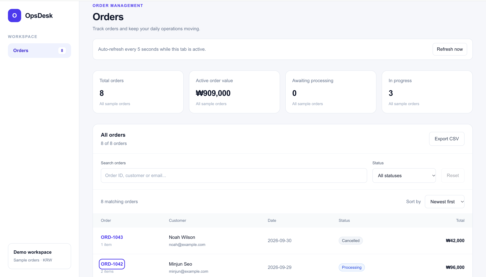
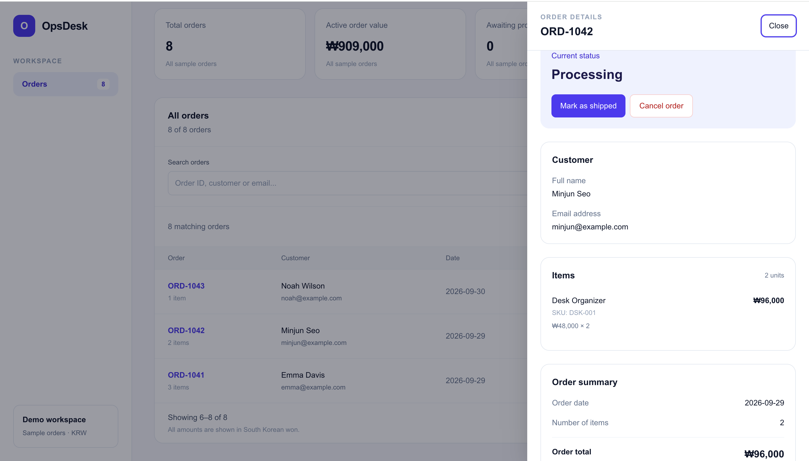
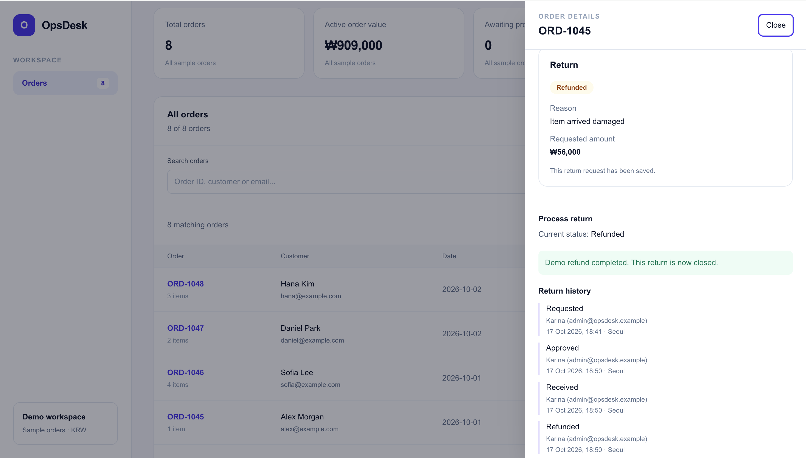

# OpsDesk

An internal order and return management application for e-commerce teams.

Built with Next.js, TypeScript, PostgreSQL, and Prisma. Employees can manage order statuses, process return requests, and review the history of each operation.

## Screenshots

### Orders workspace


### Order details


### Return processing


## Features

### Order management

- Search orders by ID, customer name, or email.
- Filter by order status.
- Sort by date or total amount.
- Browse results with pagination.
- View customer details, line items, and order history.
- Export all matching orders to CSV, including results outside the current page.

### Return management

- Create a full-order return request for an eligible delivered order.
- Select a return reason and provide a comment.
- Approve or reject a request.
- Confirm receipt of returned items.
- Record a simulated refund.
- Review return status history and the employee responsible for each action.

### Authentication and access

- Email and password authentication with Better Auth.
- Protected pages and server-side permission checks.
- Manager and administrator roles.
- An administrator-only employee directory.
- Public sign-up disabled.

### Data synchronization

- TanStack Query manages the client-side order cache.
- Active tabs refresh orders every five seconds.
- Data refreshes when returning to a tab or reconnecting.
- The order table and open detail panel use the same cached data.
- Failed refreshes retain the last loaded data and display an error.

## Technology stack

| Area | Technology |
| --- | --- |
| Application | Next.js App Router, React, TypeScript |
| Styling | Tailwind CSS |
| Server-state management | TanStack Query |
| Database | PostgreSQL |
| Database access | Prisma, PostgreSQL driver adapter |
| Authentication | Better Auth |

## Business rules

### Order workflow

`Pending → Processing → Shipped → Delivered`

Orders can be cancelled while Pending or Processing.

### Return workflow

`Requested → Approved → Received → Refunded`

A Requested return can also transition to Rejected.

- Returns are available for delivered orders within 30 days of the recorded delivery event.
- Only full-order returns are supported.
- Each order can have one return request, including a rejected request.
- Rejected and Refunded are terminal return statuses.
- The return amount is calculated on the server from the order total.
- Refunds are simulated; no bank or payment provider is connected.
- The original order remains Delivered while its return is tracked separately.

## Implementation decisions

### Server-side validation

The server checks authentication, employee permissions, input values, and allowed status transitions before writing to the database.

### Atomic updates

Status changes and their history events are written in a database transaction.

### Concurrent edits

Mutations include the expected order version. A version check prevents an outdated client from overwriting a more recent change.

### Confirmed updates

The interface updates its cache with the order returned by the server after a successful mutation. Status changes are not applied optimistically.

### Background refresh

Polling pauses during a local mutation, and in-flight reads are cancelled to prevent an older response from overwriting the mutation result.

## Local setup

### Requirements

- Node.js 22.19 or a compatible supported version
- npm
- PostgreSQL database
- A pooled and direct connection URL if using Neon

### 1. Install dependencies

From the project directory:

```bash
npm ci
```

### 2. Configure environment variables

```bash
cp .env.example .env
```

Fill in the database URLs in `.env`.

Generate an authentication secret:

```bash
openssl rand -hex 32
```

Copy the generated value into `BETTER_AUTH_SECRET`.

For local development:

```dotenv
BETTER_AUTH_URL="http://localhost:3000"
```

Never commit `.env` or real credentials.

### 3. Generate Prisma Client

```bash
npm run db:generate
```

### 4. Apply database migrations

For a fresh database, apply the committed migrations:

```bash
npm run db:deploy
```

### 5. Seed sample orders

```bash
npm run db:seed
```

The seed creates sample orders. Existing orders are not reset.

Sample delivery dates are fixed. As time passes, some orders will fall outside the 30-day return window. To test a new return, progress an eligible Pending or Processing sample order through the delivery workflow.

### 6. Create local demo employees

```bash
npm run db:seed-users
```

The employee seed creates demo administrator and manager accounts and prints generated passwords for newly created accounts in the terminal.

Store those passwords locally. Do not commit them.

### 7. Start the application

```bash
npm run dev
```

Open http://localhost:3000 and sign in with a seeded account.

## Available commands

| Command | Purpose |
| --- | --- |
| `npm run dev` | Start the development server |
| `npm run build` | Generate Prisma Client and build the application |
| `npm start` | Start the production server after a build |
| `npm run lint` | Run ESLint |
| `npm run typecheck` | Run TypeScript checks |
| `npm run db:generate` | Generate Prisma Client |
| `npm run db:migrate` | Create and apply development migrations |
| `npm run db:deploy` | Apply committed migrations |
| `npm run db:seed` | Seed sample orders |
| `npm run db:seed-users` | Create local demo employees |

## Project structure

- `src/app` — routes, server actions, and API handlers
- `src/components` — order, return, and authentication interfaces
- `src/hooks` — client-side data fetching and mutation coordination
- `src/lib` — database access, authentication, types, and business rules
- `prisma` — database schema, migrations, and seed scripts

## Verification

A production build and TypeScript check have passed locally.

Manual verification scenarios:

- Sign in and sign out.
- Search, filter, sort, and paginate orders.
- Export filtered results to CSV.
- Change an order status and verify persistence after reload.
- Process and reject return requests.
- Verify status history and employee attribution.
- Verify the administrator-only employee directory.
- Observe changes from another browser tab.
- Check that stale mutations are rejected.

Automated end-to-end tests are not included yet.

## Current scope

This is a portfolio MVP using sample data.

- Filtering, sorting, and pagination currently run on the client.
- The API returns the full order list.
- Synchronization uses polling rather than WebSockets.
- Partial returns and real payments are not supported.
- Sales charts and automated end-to-end tests are planned improvements.

[Live Demo](https://opsdesk-rho.vercel.app) · [Source Code](https://github.com/minminrina/opsdesk)

> The live application requires an employee account. Public registration is disabled.
